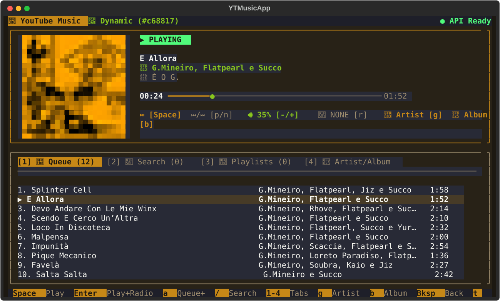
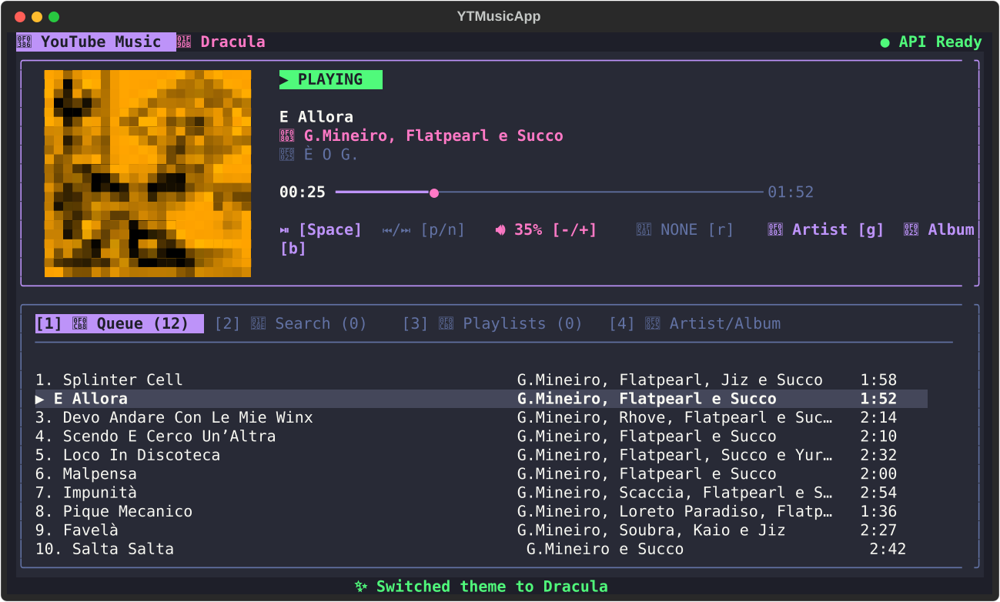
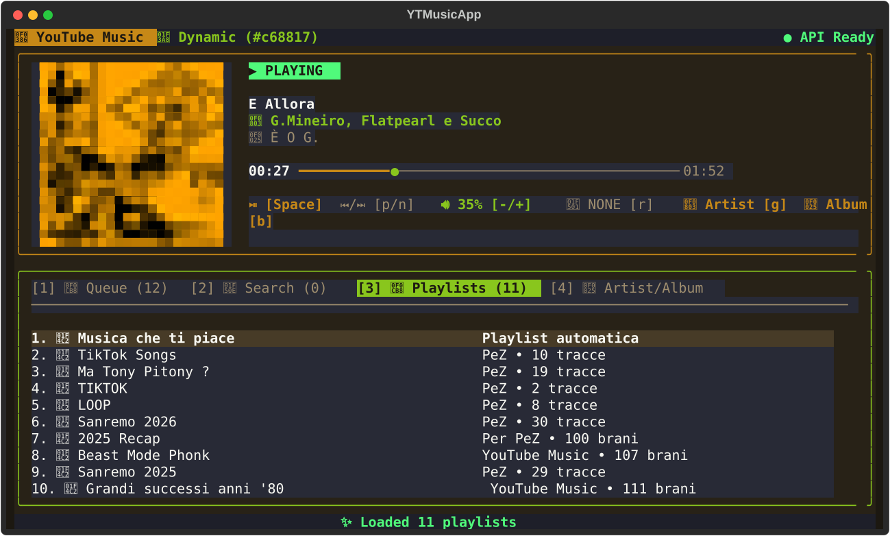
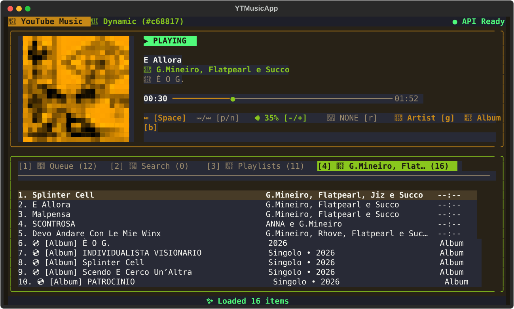

# 󰎆 yt-music-tui

A modern, 24-bit Truecolor **Terminal User Interface (TUI)** and **Waybar widget wrapper** for [YouTube Music Desktop (`th-ch/youtube-music`)](https://github.com/th-ch/youtube-music), built with [Textual](https://textual.textualize.io/), [Rich](https://github.com/Textualize/rich), and [Pillow](https://python-pillow.org/).

Designed for tiling Wayland compositors like **Hyprland**, it runs YouTube Music Desktop invisibly as a headless background daemon (no window, no tray icon) while keeping your Google session, personalized recommendations, and plugins (such as Discord Rich Presence) active.

---

## 📸 Screenshots

### Dynamic Artwork Theme (Ambient Mode) & Queue View
Automatically extracts dominant dark ambient backgrounds and vibrant accent colors directly from the currently playing album cover:



### Dracula Theme
Press `t` at any time to switch between **Dynamic Artwork** and the classic **Dracula** palette:



### Personal Playlists Browser (`[3] Playlists`)
Browse your personal YouTube Music library (`Liked Music`, custom playlists, and saved mixes):



### Artist & Album Explorer (`[4] Artist/Album`)
Press `g` to jump to the current/selected track's **Artist** (top tracks + discography) or `b` to open its **Album**:



---

## ✨ Features

- **24-bit Truecolor Album Artwork**: Downloads cover art in the background, trims 16:9 letterboxing black bars, center-crops to `1:1`, and renders double-density Unicode half-blocks (`▀`) with Lanczos resampling.
- **Dynamic Ambient & Dracula Themes**: Extracts HSV vibrant colors from the album artwork to theme borders, progress bars, and highlights in real time, or toggle to the **Dracula** theme with `t`.
- **Headless Background Daemon**: Automatically configures and launches `youtube-music` hidden in the background (`appVisible: false`, `tray: false`) without stealing focus or cluttering the system tray.
- **Smart Radio & Queue Regeneration**: Pressing `Enter` on a searched track starts playback immediately and triggers YouTube Music to generate a fresh 50-track Radio Queue (`RDAMVM...`), or loads the full Playlist/Album queue.
- **Personal Library Playlists (`[3]`)**: Reads your authenticated local YouTube Music session to list and browse all of your personal and saved playlists.
- **Artist (`g`) & Album (`b`) Navigation**: Jump directly from any playing or highlighted song to its Artist discography or full Album tracklist.
- **Linearized Volume Control**: Automatically compensates for YouTube Music's internal logarithmic volume curve so `+` and `-` step smoothly by `5%`.
- **Native Waybar Integration (`yt-music-tui waybar`)**: Outputs JSON status with play/pause icons, tooltip metadata, and CSS state classes (`playing`, `paused`, `stopped`).

---

## 📋 Requirements

- **OS**: Linux (Arch Linux / Wayland / X11)
- **Python**: `>= 3.10`
- **Python Libraries**:
  - `textual`
  - `rich`
  - `Pillow`
- **System Packages**:
  - [`youtube-music`](https://github.com/th-ch/youtube-music) (AUR: `youtube-music-bin` or `youtube-music`)
  - `playerctl` (used for MPRIS `OpenUri` radio/playlist queue generation and fallback metadata)
  - A truecolor terminal emulator with Nerd Fonts support (e.g. `kitty`, `alacritty`, `foot`, `wezterm`)

On **Arch Linux**:
```bash
sudo pacman -S python python-textual python-rich python-pillow playerctl
yay -S youtube-music-bin
```

---

## 🚀 Installation

Clone the repository and install the CLI/TUI:

```bash
git clone git@github.com:LucaPezzato/yt-music-tui.git
cd yt-music-tui
pip install --user -e .
```

Initialize the YouTube Music Desktop background configuration (`api-server` and `shortcuts` MPRIS plugins):

```bash
yt-music-tui setup --background
```

*(Note: Log into your Google account once inside YouTube Music Desktop so your cookies and library playlists are available locally).*

---

## ⌨️ Keybindings

| Key | Action |
| :--- | :--- |
| `Space` | Toggle Play / Pause |
| `n` / `p` | Next / Previous track |
| `←` / `→` (`h` / `l`) | Seek `-5s` / `+5s` |
| `+` / `-` | Volume `+5%` / `-5%` |
| `m` | Mute / Unmute |
| `r` | Cycle Repeat Mode (`NONE` / `ALL` / `ONE`) |
| `S` | Shuffle current queue |
| `L` / `D` | Like (`♥`) / Dislike (`✖`) current track |
| `1` / `2` / `3` / `4` / `Tab` | Switch between **Queue**, **Search**, **Playlists**, and **Artist/Album** tabs |
| `/` or `s` | Open Search bar (`Esc` to close) |
| `↑` / `↓` (`k` / `j`) | Move selection cursor up / down |
| `Enter` | Play selected track & regenerate Radio/Playlist queue (or open selected Playlist/Album) |
| `e` | Insert selected track right after current track (*Play Next*) |
| `a` | Append selected track to the end of the current queue |
| `g` or `i` | Open **Artist** page for the highlighted or playing track |
| `b` or `A` | Open **Album** tracklist for the highlighted or playing track |
| `Backspace` | Go back from a playlist's tracks to the Playlists overview |
| `d` or `x` | Remove selected track from Queue |
| `c` | Clear current Queue |
| `t` | Toggle theme between **Dynamic Artwork** and **Dracula** |
| `o` | Show / launch YouTube Music Desktop window |
| `q` or `Esc` | Quit TUI (music continues playing in the background) |

---

## 🖥️ Hyprland & Waybar Configuration

### Hyprland (`~/.config/hypr/hyprland.lua` or `hyprland.conf`)

Start the headless background daemon on login and open `yt-music-tui` in a centered floating popup window:

```lua
-- Autostart headless YouTube Music daemon
hl.on("hyprland.start", function ()
    hl.exec_cmd("yt-music-tui daemon")
end)

-- Floating popup window rule
hl.window_rule({
    name = "ytmusic-rules",
    match = { title = "^(ytmusic)$" },
    float = true,
    center = true,
    size = "850 500",
})
```

### Waybar (`~/.config/waybar/config`)

```jsonc
"custom/ytmusic": {
    "return-type": "json",
    "interval": 2,
    "exec": "yt-music-tui waybar",
    "on-click": "kitty --title ytmusic -e yt-music-tui",
    "on-click-right": "yt-music-tui toggle",
    "on-scroll-up": "yt-music-tui next",
    "on-scroll-down": "yt-music-tui prev"
}
```

---

## 🛠️ CLI Subcommands

```bash
yt-music-tui            # Open interactive TUI
yt-music-tui daemon     # Ensure YouTube Music is running hidden in background
yt-music-tui waybar     # Output JSON status for Waybar
yt-music-tui toggle     # Play / Pause
yt-music-tui next       # Next track
yt-music-tui prev       # Previous track
yt-music-tui vol-up     # Volume +5%
yt-music-tui vol-down   # Volume -5%
yt-music-tui like       # Like current track
yt-music-tui status     # Print current song status
```

## 📄 License

Released under the [MIT License](LICENSE).
